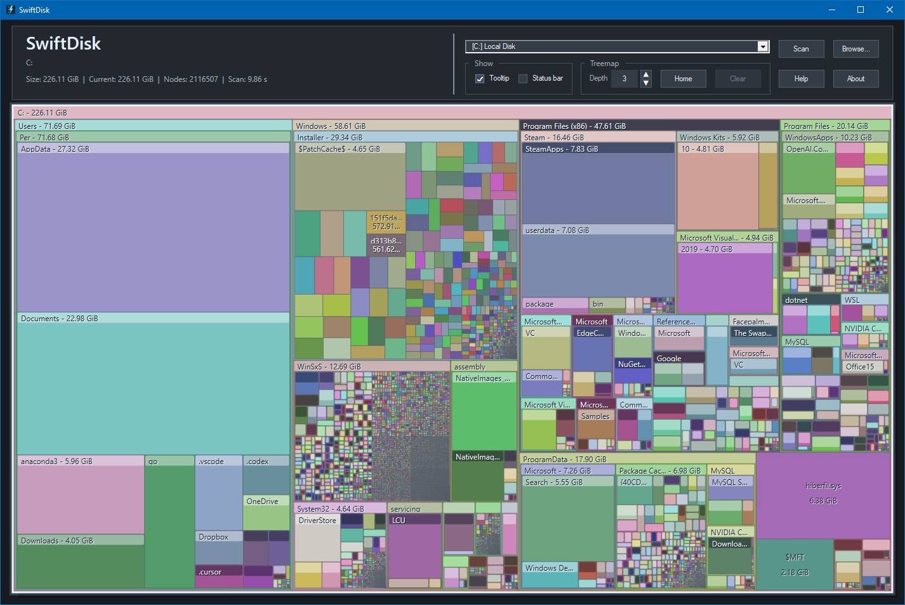

# SwiftDisk - fast disk usage visualization for NTFS drives

SwiftDisk is a disk space analyzer for Windows that helps you find what is using disk space by scanning a drive or folder and showing the result as an interactive treemap. It does this very quickly by bypassing the operating system and instead reading the information directly from the drive's NTFS Master File Table.

## Download
[Download here.](https://github.com/peredlund/SwiftDisk/releases)

## Supported Windows Versions

SwiftDisk supports Windows 10, Windows 11, and Windows Server 2016 and later.

## Screenhot



## Install

To install SwiftDisk, unzip the downloaded file to a folder where you want to keep the app. To start the app, run `SwiftDisk.exe` from the unzipped folder. Windows will show a User Account Control prompt when SwiftDisk starts since it needs administrator permission to read the NTFS Master File Table.

## Use SwiftDisk

1. Start `SwiftDisk.exe`.
2. Choose what to scan:
   - Select a drive in the path field.
   - Or type a folder path or click `Browse...` to select a folder.
3. Click `Scan`, or press Enter to start the scan.
4. Use the treemap to find large folders and files:
   - Larger rectangles use more disk space.
   - Hover over a rectangle to see its name and size.
   - Click a folder rectangle to drill into it.
   - Use the parent folder bars at the top of the treemap to go back up.
   - Right-click a rectangle to open it, show it in File Explorer, copy its path, or view properties.
5. Click `Help` to see more detailed instructions.

## Why the scan is fast
- On NTFS drives, SwiftDisk is very fast because it reads the MFT.
- NTFS is the default file system for Windows operating systems and the MFT, or Master File Table, is NTFS's own index of files and folders.
- Reading the MFT is much faster than scanning each folder one by one.

## Build From Source

SwiftDisk is a native Windows C++ application built with CMake. The build has been verified to work with Visual Studio 2026 as the CMake Generator.

```powershell
cmake -S . -B build -G "Visual Studio 18 2026" -A x64
cmake --build build --config Release
```

The executable is written to:

```powershell
build\Release\SwiftDisk.exe
```
## License

SwiftDisk is released under the GNU General Public License version 3. See [LICENSE](LICENSE).
